# Pixel Sandbox

**Um RPG de mundo aberto em pixel art, com personagens em 2D dentro de um mundo em 3D.**
Era medieval sombria, oito povos em guerra e em paz, noites que ficam perigosas e uma história que ainda está sendo escrita.

Feito em **Godot 4.4** por uma pessoa só.

> **Aviso:** o jogo tem violência explícita, com desmembramento e cenas de morte com muito sangue.
>
> **Estado:** em desenvolvimento. O mapa e as aldeias são desenhados à mão no editor do próprio jogo. Esta página é só uma apresentação: o jogo ainda não está disponível para baixar, e o código não está aqui.

  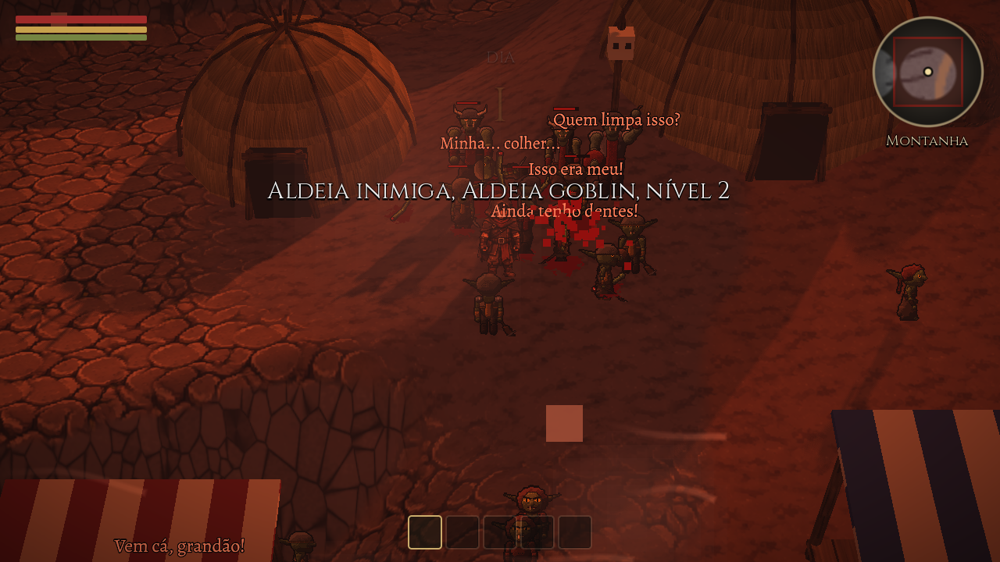

---

## Em poucas linhas

| | |
|---|---|
| **Visual** | Personagens 2D desenhados em pixel art, num mundo 3D com luz, sombra e câmera que gira de 90 em 90 graus |
| **Mundo** | Mapa de 1920 x 1440 tiles, cinco biomas (com a Terra de Brasa), dia e noite, chuva, vento, quatro estações e oito fases da lua |
| **Povos** | Oito: humanos, orcs, elfos, goblins, anões, gigantes, gnomos e infernais |
| **Guerra** | Convoque o exército de um povo, ataque aldeias, conquiste, roube ou queime |
| **Vida** | Plantar, pescar, minerar, forjar, criar itens, acampar, dormir em casa e ler numa biblioteca |
| **Cenas** | Uma cena de morte diferente para cada tipo de assassino |
| **Editor** | O mapa inteiro é feito no editor do próprio jogo |

---

## Galeria

<table>
  <tr>
    <td width="50%">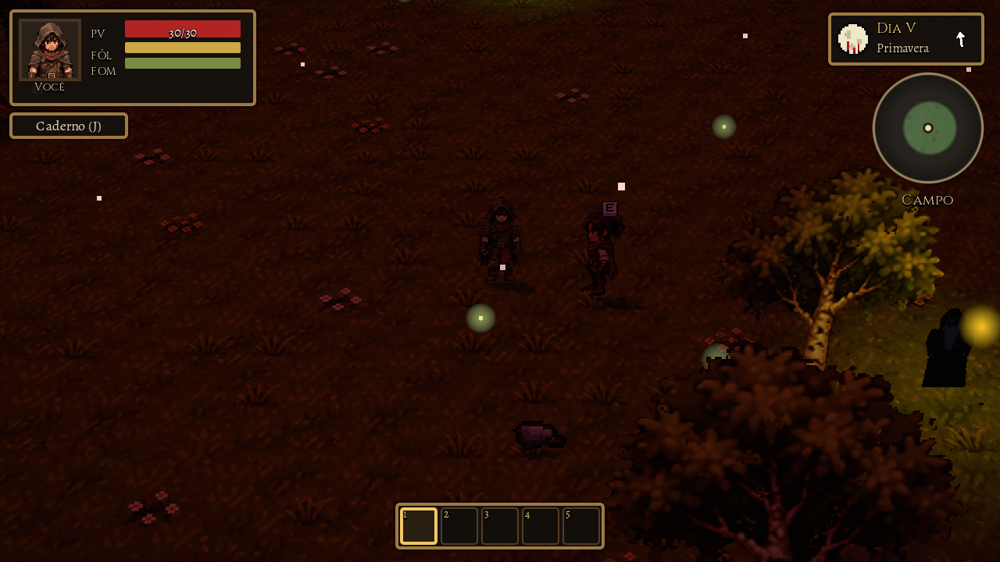 Lua de sangue: o céu fica vermelho e os monstros, mais fortes.</td>
    <td width="50%">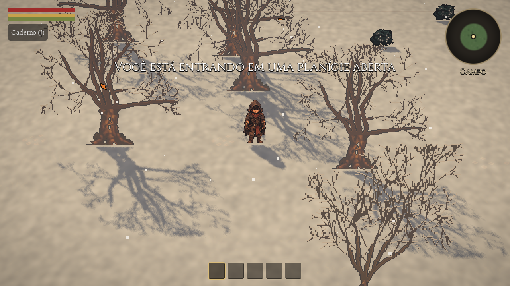 Inverno: neve, árvores peladas e frio que machuca.</td>
  </tr>
  <tr>
    <td>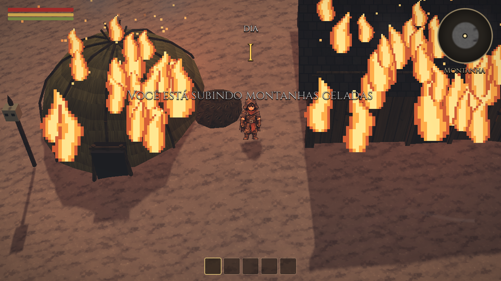 Conquistou a aldeia? Dá para roubar ou queimar cada casa.</td>
    <td>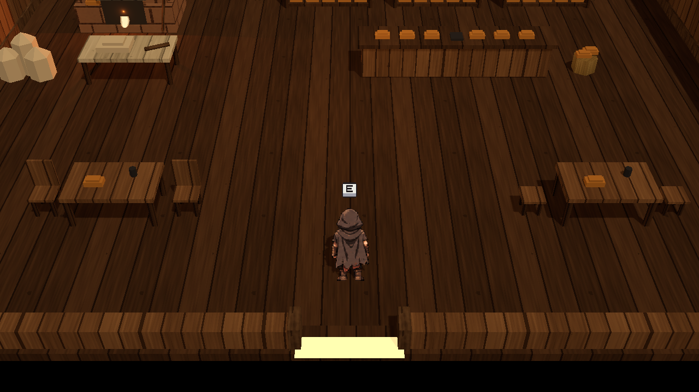 Por dentro da padaria.</td>
  </tr>
  <tr>
    <td>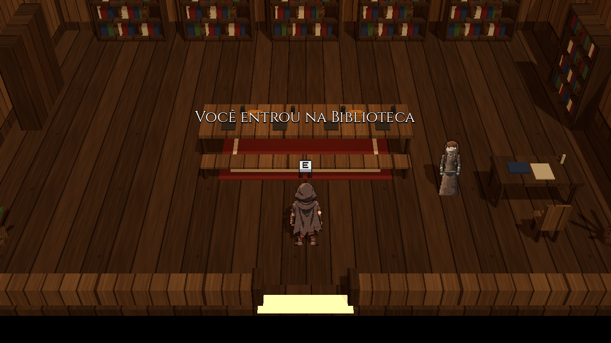 A biblioteca, onde livros em PDF viram páginas dentro do jogo.</td>
    <td>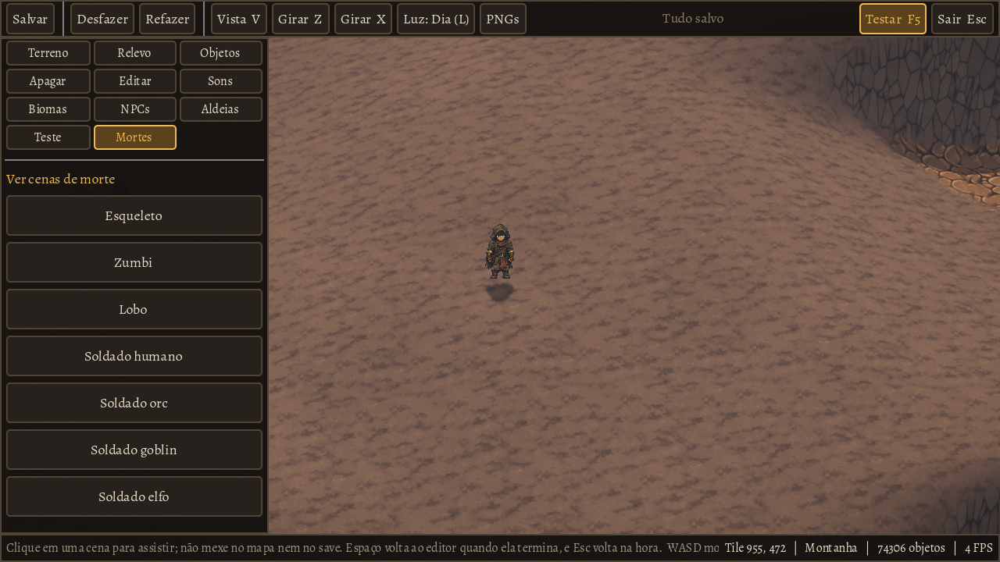 O editor de mapa.</td>
  </tr>
</table>

---

## Os oito povos

Cada povo tem homens e mulheres, civis, soldados, um chefe, falas, construções e um jeito próprio de convocar o exército.

  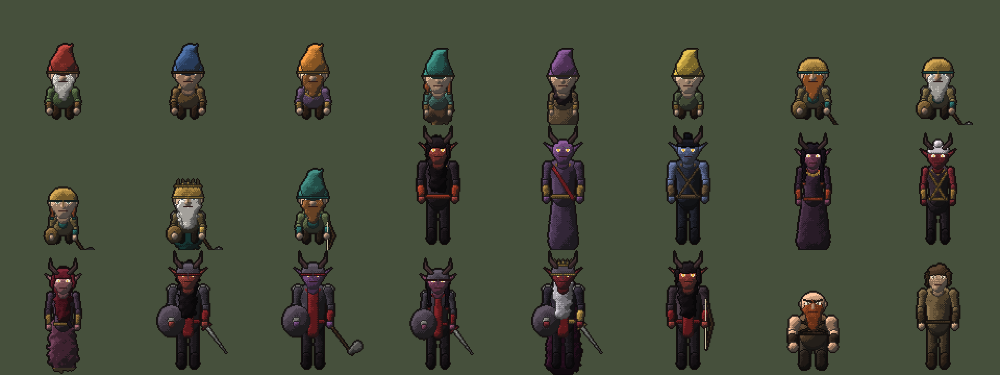 
  Os gnomos, de gorro pontudo, e os infernais, de chifres e olhos de brasa.

| Povo | Como é | Convoca com |
|---|---|---|
| **Humanos** | A média de todos. Sempre amigos seus, e a vila deles é zona neutra: não entra em guerra, não pode ser conquistada e nunca te ataca | Sino |
| **Orcs** | Fortes e muito burros, de vista curta | Trombeta |
| **Elfos** | Sinceros e leais. Donos do cristal | Harpa |
| **Goblins** | O povo mais rico, covarde e manipulador | Saco de moedas |
| **Anões** | Pacíficos, diplomáticos e inteligentes. Donos do metal negro, o melhor material do jogo. Vivem em cavernas | Bigorna de guerra |
| **Gigantes** | Fortes e inteligentes, mas comilões e sempre com fome. Têm o dobro da altura de um humano | Tambor de guerra |
| **Gnomos** | Frágeis, inteligentes e inofensivos. Inventores e desmontadores de tudo | Engrenagem de guerra |
| **Infernais** | De chifres e olhos de brasa, inimigos de todos | Braseiro e gongo |

**Alianças:** os gnomos são amigos dos elfos, e os gigantes, dos orcs. Fechar pacto com um povo vale para o amigo dele. Goblins e infernais não têm amigos.

### Os líderes

Cada povo tem na aldeia principal um líder que vai passar as missões. Todos se escondem na guerra e nunca morrem.

  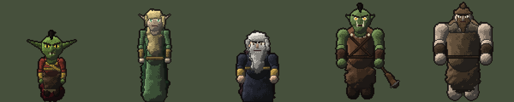 
  Rabi, o Ladrão; Son of the Tree; Dvalin Veio-Negro; Zulu; Brumgar Boca-Larga.

Os infernais são só inimigos, sem líder.

### Reputação

Cada povo guarda uma opinião sobre você, de −100 a 100, na aba **Povos** do caderno.

| O que você faz | Efeito |
|---|---|
| Conversar com um civil (primeira vez no dia) | +2 |
| Comprar numa barraca | +1 |
| Fechar pacto | +60 |
| Matar um soldado | −4 |
| Matar um civil | −10 |
| Roubar ou queimar uma casa | −10 ou −20 |
| Conquistar uma aldeia | −30 |

Com **40 ou mais**, as barracas vendem 20% mais barato e os civis te recebem bem. Com **−40 ou menos**, ninguém vende nem conversa. A reputação com um povo também sobe pela metade no amigo dele.

---

## Guerra

- **Convocar:** cada povo chama o exército do seu jeito. Os soldados marcham em formação atrás de você, desviam de obstáculos e lutam ao seu lado.
- **Ponto de volta:** convocar salva o jogo. Se morrer na guerra, você volta ao lado do chamado.
- **Clima de guerra:** ao pisar na aldeia atacada, a tela fica avermelhada, entram tambores, cinza e fumaça.
- **Defesas:** torres de vigia dão o alarme, torres de arqueiros atiram flechas que dá para desviar, e os portões abrem para os soldados saírem e se fecham atrás deles.
- **Conquista:** quando os soldados acabam, a aldeia é sua. Os civis saem das casas, tristes e com medo, e você escolhe entre roubar e queimar.
- **Aldeia principal:** guarda o chefe, com soldados mais fortes e portões trancados. Só se chega lá conquistando antes as sub-aldeias do povo.
- **Pacto:** feito numa sub-aldeia, vale para o povo inteiro. Antes do pacto, ninguém te ataca, mas nenhuma porta de aldeia abre para você. Depois, os outros povos viram inimigos.

---

## A Terra de Brasa

O bioma dos infernais. Não tem árvores, o céu e o chão ficam vermelhos, e em vez de chuva caem brasas.

  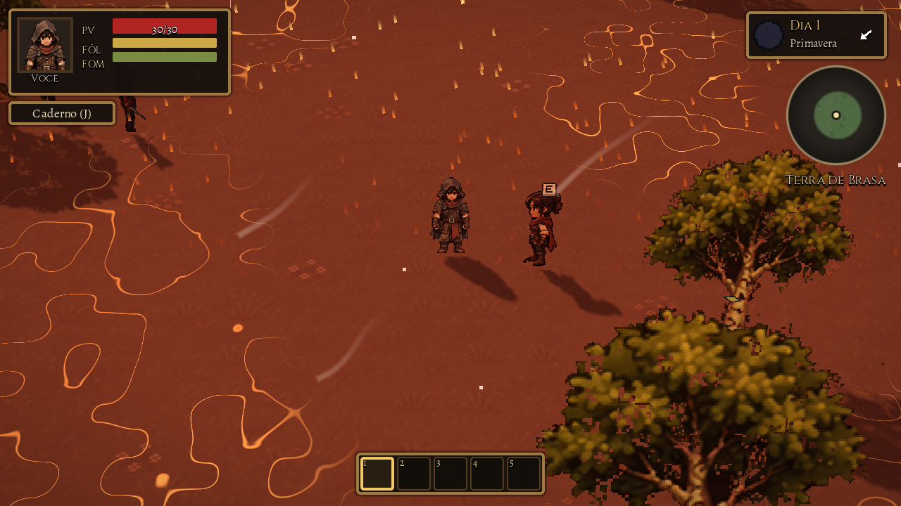 
  Chuva de fogo, chão em brasa e infernais errantes ao longe.

- **O chão queima:** andar nela sem proteção faz você perder vida em ondas cada vez mais fortes, até morrer. Protegem as **Botas de Brasa** e o amuleto dos infernais.
- **Mini vulcões:** quebrados com picareta de pedra ou melhor, soltam **enxofre** e voltam em alguns dias.
- **Vulcão grande:** nas noites de lua de sangue entra em erupção, com explosões de lava e uma chuva de fogo ainda mais forte.
- **Infernais errantes:** nascem ali, nunca saem do bioma e atacam outros bichos, que por isso nem chegam perto.
- **No minimapa:** a área aparece em vermelho, e a montanha em azul acinzentado.

  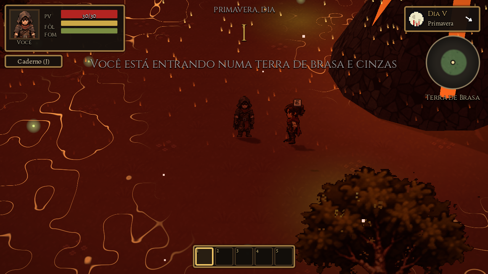

---

## Tempo, clima e noite

- **Dia e noite:** um dia dura 35 minutos reais.
- **Quatro estações de 7 dias:** primavera, verão, outono e inverno, com cores, folhas, neve e sons próprios. No inverno a fome aperta, não dá para plantar e o frio machuca longe do fogo.
- **Vento, chuva e névoa:** o vento tem direção de verdade e a seta dele aparece no selo do dia. A chuva escurece o dia e traz trovão, e a névoa da manhã sobe e some no meio da manhã.
- **Fases da lua:** oito, em ciclos de oito dias. A lua nova deixa a noite escura e os monstros cegos. A lua cheia é a **lua de sangue**: o céu fica vermelho, os monstros ficam 50% mais fortes e aparecem o dobro.

### A noite é perigosa

Zumbis, esqueletos, **aranhas**, **fantasmas** e **goblins de ronda com tocha** saem à noite. Eles não nascem perto de aldeias, de postes nem de fogueiras, e somem quando o sol nasce.

- Se você correr para uma aldeia amiga, os soldados te protegem. Os que morrerem na luta voltam no dia seguinte.

---

## Combate e criaturas

- Combate em tempo real, com golpes, atordoamento e barras de vida.
- **Armas na mão:** espada, machado, picareta, enxada, vara de pesca e arco aparecem segurados, andando e correndo.
- **Bichos:** esqueleto, zumbi, lobo, aranha, fantasma, vaca, galinha, veado, corvo e sapo, cada um com seus sons e seu jeito de agir.
- **Gore:** desmembramento conforme a vida cai, sangue vermelho, sangue verde nos zumbis, poeira nos esqueletos e pedaços pelo chão.
- **O corvo:** matar o primeiro corvo do jogo dispara um presságio: o herói de costas, relâmpagos no horizonte e um trovão. Só acontece uma vez.
- **Masmorras e cavernas:** a masmorra tem três salas ligadas por escada, com esqueletos e zumbis, e um baú no fim. A caverna dos anões tem forja, bigorna e lingotes.

### Uma cena de morte para cada assassino

| Quem mata | Como |
|---|---|
| Esqueleto | Arranca seus órgãos, com risada sádica |
| Zumbi | Te come |
| Lobo | Te dilacera e uiva |
| Humano | Uma espadada só |
| Orc | Clava na cabeça |
| Goblins | Vários te furando sem parar |
| Elfo | Flechas, estocada e corte na garganta |
| Anão | Uma picaretada que atravessa a barriga |
| Gigante | Te ergue e te rasga em dois |
| Gnomo | Te enlouquece, até você cair rindo |
| Infernal | Uma bola de fogo que te queima vivo |

  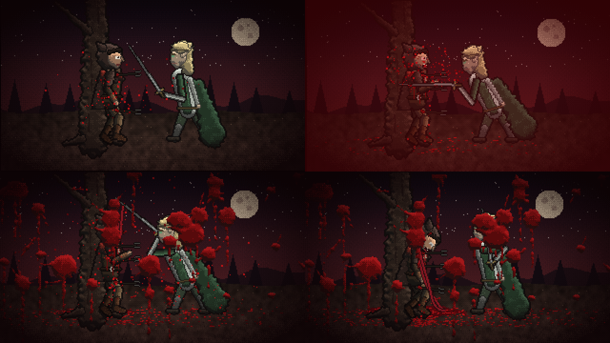

---

## Minérios, itens e criação

  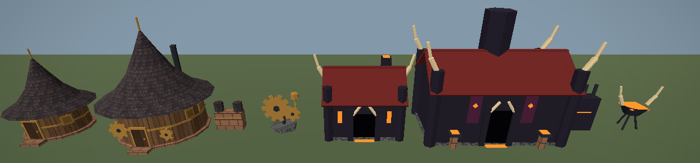 
  Casas e oficinas dos gnomos, casas e salões dos infernais.

- **Seis minérios:** ferro, carvão, cristal, metal negro, cobre e enxofre. As rochas só quebram com picareta.
- **Itens de cada minério:** espada, armadura e flechas de **cobre**, **ferro**, **metal negro** (o melhor, dos anões) e **cristal** (dos elfos). A flecha mais forte que você tiver é a que o arco usa.
- **Craft descoberto:** cada receita fica como "???" até você pegar um dos ingredientes. Antes disso só dá para ver o tipo do que ela pede, e o jogo avisa quando uma receita é descoberta.
- **Hierarquia de mineração:** a picareta improvisada quebra só pedra, a de pedra quebra ferro, carvão, cobre e enxofre, a de ferro quebra metal negro e só a de metal negro quebra cristal. O carvão derrete o ferro em **barras**, que viram as ferramentas e armas de ferro.
- **Forja dos anões:** os itens de metal só se forjam dentro das cavernas dos anões, na forja ou na bigorna, e cada peça gasta carvão que você mesmo traz. Os anões deixam claro que não são seus escravos para fornecer material.
- **Ferramentas gastam:** picaretas, machados, espadas, arco e enxada têm um número de usos e quebram quando acabam. Os usos restantes aparecem ao lado do nome.
- **Comida estraga:** cada comida tem um prazo, de 3 dias (mirtilo) a 12 (batata), e some quando vence.
- **Amuletos de cada povo:** um para cada povo, com habilidades dele. Velocidade e arco forte dos elfos, mão de forja e imunidade ao frio dos anões, mochila maior dos gnomos, vida a mais dos gigantes.

  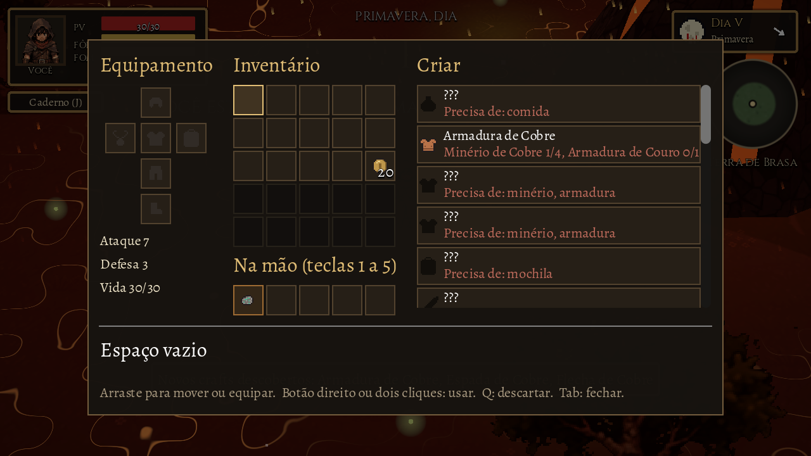 
  Receitas ainda não descobertas aparecem como ???.

  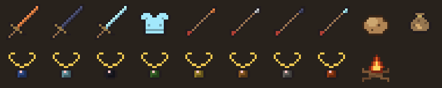 
  Parte dos itens novos: espadas, armadura de cristal, flechas, batata, os oito amuletos e a fogueira.

- **Do chão:** galhos e pedras mudam de lugar a cada dia, e dão ferramentas improvisadas.
- **Na mão:** a ferramenta aparece segurada. O machado derruba árvores mais rápido, a picareta quebra rochas mais rápido e a espada aumenta o dano.

---

## Cultivo, pesca e acampamento

<table>
  <tr>
    <td width="50%">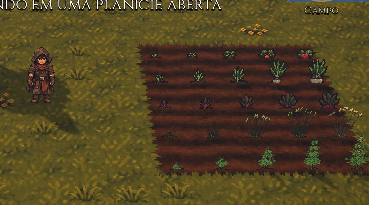 Cada linha uma planta, da semente até a colheita.</td>
    <td width="50%">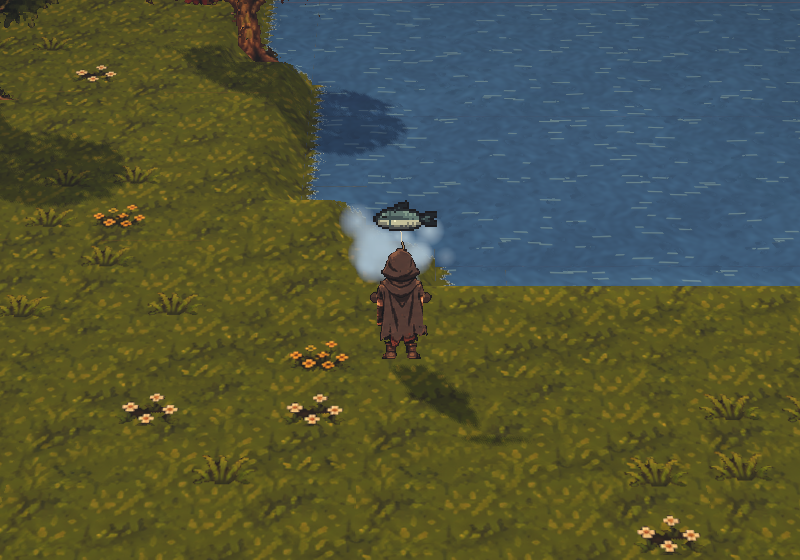 O peixe saindo da água.</td>
  </tr>
</table>

- **Arar:** com a enxada, a terra vira canteiro, e canteiros vizinhos se emendam numa plantação. Só se planta a até 8 tiles de água.
- **Plantas:** rabanete, nabo, batata, beterraba, trigo e maconha, cada uma com seu tempo e sua forma. Fumar a maconha deixa a tela rosa e ondulando, e depois você apaga e acorda no outro dia.
- **Plantas do inverno:** mirtilo-branco, lírio-da-geada e cogumelo-lume nascem sozinhos só no inverno e brilham no escuro.
- **Pesca:** lance a linha, espere o peixe morder e puxe no tempo certo.
- **Fogueira de acampamento:** um craft para quando você está longe de casa. Dá para dormir nela à noite, e ao acordar ela vira cinzas.
- **Fome e frio:** a fome baixa com o tempo, e o frio aparece no inverno, nas noites de outono e na montanha.

  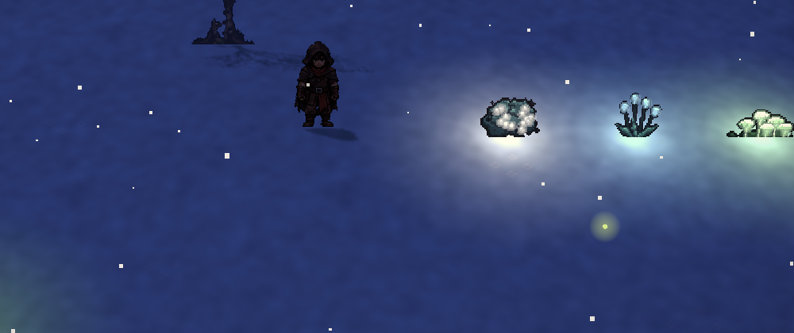

---

## Casas, eventos e biblioteca

- **Interiores 3D:** casas, ocas, salões, uma padaria e uma biblioteca, cada um por dentro, com poeira no ar e a chuva abafada lá fora. O sobrado e a torre élfica têm segundo andar.
- **Moradores:** as casas das aldeias têm um ou dois moradores do povo, sentados de dia e em pé à noite, que conversam e comentam a vida.
- **Cama:** nas casas do povo do seu pacto, a cama deixa você dormir, salvar o jogo e escolher aquela casa como lar.
- **Eventos de casa:** em cada vila, uma casa tem chance de guardar uma cena.

  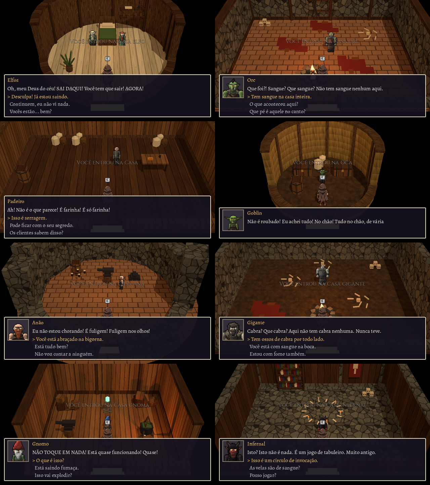

Elfos pegos de surpresa na cama, um orc numa casa ensanguentada jurando que nada aconteceu, um padeiro com serragem na farinha, um goblin cheio de coisas "achadas", um anão chorando abraçado à bigorna, um gigante com ossos de cabra, um gnomo com uma máquina soltando fumaça e um infernal com um "jogo de tabuleiro" cheio de velas.

- **Biblioteca:** uma construção com estantes e uma bibliotecária. Os livros são PDFs convertidos para páginas que você lê dentro do jogo.
- **Escritos fragmentados:** livros e pergaminhos espalhados pelo mundo que você junta aos poucos no caderno.

---

## Interface e controles

Uma interface de RPG clássico, em molduras de couro e ouro. No canto superior esquerdo ficam o retrato e as barras de vida, fôlego, fome e frio. No canto superior direito, o selo do dia, com a fase da lua, a estação e a seta do vento, e o minimapa redondo logo abaixo. Embaixo, a hotbar de cinco espaços.

| Tecla | Ação |
|---|---|
| WASD ou setas | Andar |
| Shift | Correr (gasta fôlego) |
| Clique ou F | Bater, usar a ferramenta ou o item da mão |
| E | Conversar, entrar, pegar, usar, comprar |
| Tab ou I | Inventário e criar itens |
| 1 a 5 | Hotbar |
| J | Caderno: anotações, bestiário, suas notas e povos |
| Z e X, ou botão do meio arrastando | Girar a câmera |
| Roda do mouse | Aproximar ou afastar |
| Esc | Pausa, salvar, configurações |

**Dificuldades:** *Relaxante* (ninguém briga, só você, e não tem fome), *Normal* e *Difícil* (ao morrer, seus itens ficam no chão por 3 dias, a fome é mais rápida e as aldeias rivais sobem de nível mais rápido).

---

## O editor de mapa

O mapa inteiro é desenhado à mão no editor do próprio jogo, aberto pelo menu inicial.

- **Clicar para editar:** clique em qualquer coisa no mapa e as opções dela aparecem ao lado.
- **Ferramentas:** pintar terreno, mudar o relevo, colocar objetos com busca e categorias, e arrastar muros em linha reta.
- **Áreas:** demarcar biomas e aldeias dos oito povos, com um resumo do que falta em cada aldeia.
- **NPCs:** definir raio, rotas e distância de perseguição, e marcar personagens da história.
- **Teste:** um modo de teste para clicar onde nascer, e um painel para pular o dia, chamar a guerra, dar itens e ver as cenas de morte.

---

## A história

A história ainda está sendo escrita, e o jogo já tem uma abertura, um despertar e os primeiros personagens. Para não estragar a surpresa, ela fica de fora desta página.

### Próximos passos

- Missões e a história principal, a começar pelos líderes de cada povo.
- Colocar as aldeias, as cavernas, as masmorras e os minérios no mapa.
- Armadilhas e variedade nas masmorras.
- Definir a parte online: a ideia é um MMORPG com história, mas ainda não há rede nem servidor.

---

## Como é feito

- **Motor:** Godot 4.4, em GDScript. A lógica é em 2D e a imagem é montada em 3D.
- **Arte:** os personagens principais e as árvores partem de pranchas desenhadas pelo autor. O resto é gerado por scripts em Python.
- **Som:** músicas e efeitos gerados por código, mais gravações de domínio público ou CC0, com os autores creditados dentro do projeto.
